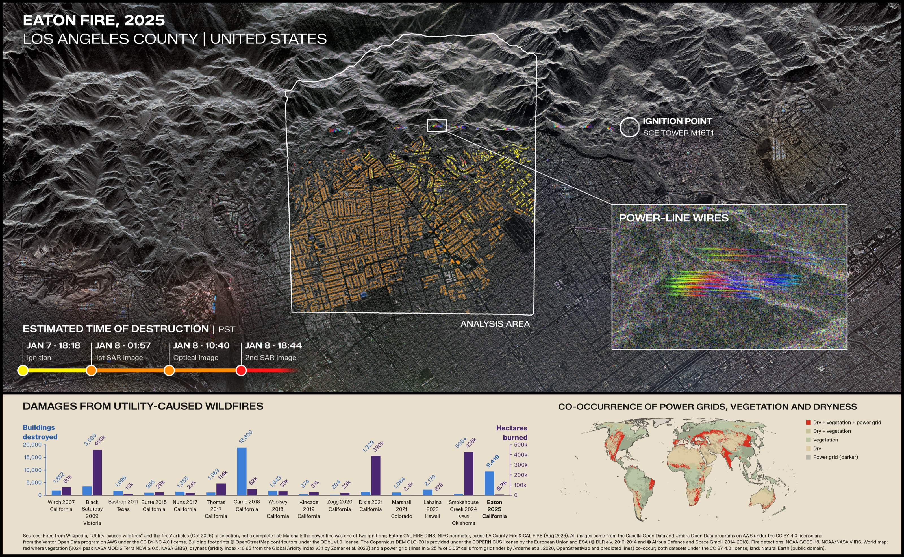

# Earth at Risk Image Contest 2026

This repository contains my submission to the Earth at Risk Image Contest 2026. It highlights the interaction between human activity and natural hazards using the example of the 2025 Eaton Fire in Altadena, Los Angeles County, United States.

Here's a low-res version of the submission and you can also check out the [high-res version](https://github.com/clarahoffmann/earth-at-risk/blob/main/image/submission.png) and an overview [GitHub Pages](https://clarahoffmann.github.io/earth-at-risk).

## Story
Los Angeles County regularly experiences strong, dry winds, called the Santa Ana winds. These winds build up in the desert and travel towards the Pacific Ocean. The Santa Ana winds can carry small sparks over large distances. So when they're in season, strong anti-fire measures have to be taken to avoid wildfires.\
For example, power transmission lines have to be turned off. However, in 2025, an out-of-service transmission tower caused electrical arcing [1]. You can imagine such arcing as a high-power discharge between two conductors. You might have seen such a discharge between a train and its overhead wires.\
The arcing triggered a large wildfire, which quickly spread into Altadena. There it destroyed 9,419 structures and was only fully contained after 24 days [2].

## Methodology
The analysis looks at how quickly the fire destroyed buildings, based on a time series of Synthetic Aperture Radar (SAR, 8 images) [5, 6], optical (1 image) [9] and infrared (2 images) [7, 8] satellite imagery. Building footprints from OpenStreetMap [10] are first overlaid on each SAR image, and then the radar backscatter within each footprint is used to predict the probability that a building is intact or destroyed using a Light Gradient Boosting Machine. The definition of destroyed follows the CAL FIRE Damage Inspection (DINS) Data [3] and a structure counts as destroyed if more than 50% of it is damaged.\
A change-point detection model is then fitted to the probabilities of destruction for each building in each image. This gives the most probable timeframe of destruction. Estimates are further refined using optical and infrared satellite data. Most buildings appear destroyed within 8 (${\color{goldenrod}\textsf{yellow}}$) and 8-24 (${\color{orange}\textsf{orange}}$) hours after ignition, captured by the first two SAR images. Only a few buildings were destroyed later (${\color{red}\textsf{red}}$), potentially due to different fire exposure, later collapse or detection errors.

## How to interpret the SAR image
SAR satellites are active sensors. They send out microwaves to Earth and use the echo to form an image. Microwaves pass through smoke, clouds and fog, and SAR works day and night. Thus, SAR can be used to monitor damage and provide helpers quickly with information.
The SAR image in the background is colorized based on sub-apertures. You can imagine a SAR satellite like a giant microwave flashlight from space, which takes a video ($\approx$ aperture) while illuminating at the area of interest from different angles. While each video frame on its own is blurry, we can summarize this video into one high-resolution image. To give the SAR image a bit more color, we can split the video into 3 sub-videos (=sub-apertures) and assign each sub-video to one color channel. Let's assume our video was taken over 30 seconds. Then all objects that reflected strongly in the ${\color{red}\textsf{first 10 seconds}}$ (but not in the remaining 20 seconds) are ${\color{red}\textsf{red}}$, all objects that reflected strongly in the ${\color{green}\textsf{next 10 seconds}}$ (but not in the first and last 10 seconds) are ${\color{green}\textsf{green}}$, and the objects reflecting strongly in the ${\color{blue}\textsf{last 10 seconds}}$ (but not the first 20 seconds) are ${\color{blue}\textsf{blue}}$.\
Objects that reflect similarly during the entire aperture are in grayscale.\
This colorization beautifully highlights the power lines at the top of the analysis area. If you're interested in how exactly these arise, you can check out [this paper](https://elib.dlr.de/206480/1/Complex%20scattering%20mechanisms%20at%20power%20lines%20in%20X-Band%20SAR%20imagery-final.pdf) by Ma et al., 2024 [4].

## Impact
This utility-caused wildfire was not the first in California or worldwide. The bottom bar chart shows damage caused by selected utility-caused wildfires since 2007. They are a risk not only in California. Worldwide, there are many areas where power grids are located in dry climates and close to vegetation. You can see such areas on the map marked in red.\
So what can be done about it? Overhead power lines need to be inspected regularly and overgrown or dry vegetation has to be cut back. During high-risk times, the power needs to be shut off. Power lines underground or heavily insulated lines are an even better solution.

**Sources:**\
[1] [Investigative Reports on the Cause of the Eaton Fire](https://lacounty.gov/2026/08/04/county-of-los-angeles-fire-department-releases-the-investigative-reports-on-the-cause-of-the-eaton-fire/) by the County of Los Angeles Fire Department\
[2] [Eaton Fire Incident](https://www.fire.ca.gov/incidents/2025/1/7/eaton-fire) - State of California\
[3] [CAL FIRE Damage Inspection (DINS) Data](https://data.ca.gov/@cal-fire/cal-fire-damage-inspection-dins-data) - State of California\
[4] Ma, Sijie, et al. "Complex scattering mechanisms at power lines in X-Band SAR imagery." IEEE Geoscience and Remote Sensing Letters 21 (2024): 1-5.\
[5] [Capella Space Open Data](https://registry.opendata.aws/capella_opendata/) - Capella Space, Registry of Open Data on AWS ([CC BY 4.0](https://creativecommons.org/licenses/by/4.0/))\
[6] [Umbra Open Data](https://registry.opendata.aws/umbra-open-data/) - Umbra, Registry of Open Data on AWS ([CC BY 4.0](https://creativecommons.org/licenses/by/4.0/))\
[7] [NOAA GOES-18](https://registry.opendata.aws/noaa-goes/) - NOAA, Registry of Open Data on AWS\
[8] [VIIRS Active Fire Detections](https://firms.modaps.eosdis.nasa.gov/) - NOAA/NASA, Fire Information for Resource Management System (FIRMS)\
[9] [Vantor Open Data Program](https://registry.opendata.aws/vantor-open-data/) - Vantor, Registry of Open Data on AWS ([CC BY-NC 4.0](https://creativecommons.org/licenses/by-nc/4.0/))\
[10] [OpenStreetMap](https://www.openstreetmap.org/copyright) - © OpenStreetMap contributors ([ODbL 1.0](https://opendatacommons.org/licenses/odbl/1-0/))
